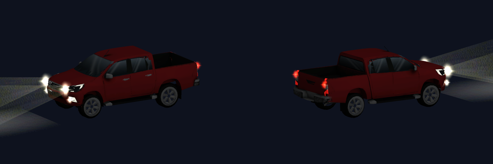
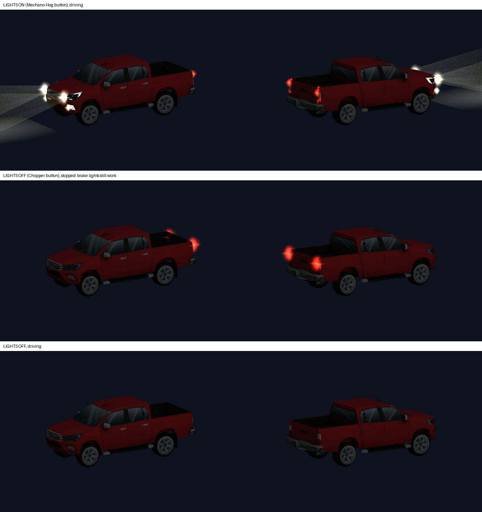

# Truck Mount for WoW 3.3.5a (AzerothCore)

A drivable pickup truck mount with working headlights, tail lights and brake lights.
Two buttons in the spellbook:

| Spell | What you get |
|---|---|
| **Truck with Lights** | headlights + light beams on, tail lights on, brake lights when you stop |
| **Truck with No Lights** | lights off, brake lights still come on when you stop |

Both carry a passenger (2 seats). Click the button, no commands to type.



**Download:** grab `TruckMount-v1.0.zip` from the [Releases](../../releases) page
(or click **Code → Download ZIP** on this page).

---

## How it works (30-second version)

The truck replaces the look of two existing vehicle mounts, so no server code or
compiling is needed:

* **Server** – the installer gives every character the two mount spells
  (55531 and 60424) and makes new characters start with them.
* **Players** – a client patch (`patch-5.MPQ`) contains the truck model,
  textures and the new spell names.

Players **without** the patch can still join; they just see the old motorcycle.

---

## For players

Ask your server admin if the server has the truck. Then:

**Windows** – open the `client` folder and double-click **`install-client.bat`**.
If it can't find WoW, drag your WoW folder (or `Wow.exe`) onto `install-client.bat`.

**Linux / Steam Deck** – open a terminal (Desktop Mode → Konsole) in the `client` folder:

```bash
bash install-client.sh
# or tell it where WoW is:
bash install-client.sh "/path/to/your/WoW"
```

It finds WoW (also inside Steam/Proton and Lutris folders), copies the patch into
`WoW/Data/` and clears the `Cache` folder. If `patch-5.MPQ` is already used by
another mod, it picks the next free name (`patch-6.MPQ`, …) instead of overwriting it.

**By hand:** copy `client/patch-5.MPQ` into `WoW/Data/` and delete the `WoW/Cache` folder.

In game: **Spellbook → Mounts** → drag the trucks to your action bar.

---

## For server admins

Works with AzerothCore 3.3.5a, including the playerbots fork and Docker setups.

**Linux / Steam Deck / Docker:**

```bash
cd server
bash install.sh                              # finds worldserver.conf by itself
bash install.sh /path/to/worldserver.conf    # or point to it
```

**Windows:** in the `server` folder double-click **`install.bat`**
(or drag `worldserver.conf` onto it).

Then **restart worldserver**.

What the installer does:

1. Finds `worldserver.conf` (asks if there's more than one).
2. Reads the database logins from it. Docker setups are detected automatically
   (logins come from `docker-compose.yml` + `.env`, port `DOCKER_DB_EXTERNAL_PORT`).
3. Adds the truck spells to every existing character and to new characters.
4. Sets `PlayerStart.CustomSpells = 1` (backup saved as `worldserver.conf.bak-truck`).

No `mysql` program? On Linux it uses a small built-in client (needs only `python3`,
which the Steam Deck has). If neither works it tries the database container directly.

Then hand the `client` folder to your players.

### Manual install (any MySQL tool, e.g. HeidiSQL)

Run `server/sql/install_world.sql` on **acore_world** and
`server/sql/install_characters.sql` on **acore_characters**, set
`PlayerStart.CustomSpells = 1` in `worldserver.conf`, restart.
Single character as GM: `.learn 55531` and `.learn 60424`.

---

## Uninstall

* **Server:** `bash install.sh --uninstall` or double-click `uninstall.bat`, then restart worldserver.
  Only the spells the installer handed out are removed – a Mechano-Hog or
  Mekgineer's Chopper someone crafted for real stays.
* **Players:** `bash uninstall-client.sh` or double-click `uninstall-client.bat`.
  Only the truck patch is removed (it's recognised by its checksum), other patches are left alone.

---

## Troubleshooting

| Problem | Fix |
|---|---|
| Truck is solid green or has wrong colours | Old patch or old cache. Run the client installer again (it clears `Cache`). |
| I see a motorcycle, not a truck | The patch isn't loaded: check it's in `WoW/Data/` (not `Data/enUS/`) and restart WoW completely. |
| Spellbook has no truck | Server side not installed, or worldserver not restarted. Admin: run the server installer. |
| Spell names show "Mechano-Hog" / "Mekgineer's Chopper" | Another patch with its own `Spell.dbc` loads after ours (higher number/letter). The truck still works – only the names differ. |
| Spell names blank / strange | The names are only changed for English clients (enUS/enGB). The truck itself works in every language. |
| Server's custom spells broke after installing the patch | Your server ships its own `Spell.dbc` in a patch. Ours replaces it if loaded later: rename the truck patch to a lower number than yours (e.g. `patch-4.MPQ`). |
| `Access denied for user ...` | Wrong DB login. Docker: check `DOCKER_DB_ROOT_PASSWORD` in `.env`. Or use the manual SQL. |
| `MySQL not running` | Start the database (Docker: `docker compose up -d`) and run the installer again. |

---

## Good to know

* The truck replaces the **look of the Mechano-Hog and Mekgineer's Chopper** for anyone
  with the patch – also for players who crafted the real ones.
* The lights on/off choice is per button, both use the same model with a different skin.
* Model: Toyota Hilux style pickup based on a free model from **cadnav.com** –
  reduced to about 9k triangles, re-textured with a baked texture, glass windows and lights added.
  Please keep this credit, and don't pull the model out to re-sell it.
* World of Warcraft and its files belong to Blizzard Entertainment.
  This is a fan-made mod for private/test servers.

## Files

```
client/   install-client.bat / .sh, uninstall-client.bat / .sh, patch-5.MPQ   <- give this to players
server/   install.bat / .sh, uninstall.bat, install.ps1, sql/, tools/        <- for the server admin
docs/     screenshots
tools/    m2-mount-workshop.html  <- drag-and-drop OBJ -> M2 converter to make your own mount model
```



## Make your own mount model

Open `tools/m2-mount-workshop.html` in a browser, drop in an OBJ + MTL + textures, and it
writes WoW 3.3.5a `.m2` / `.skin` / `.blp` files. Name parts `Wheel*` to make them spin,
`Glow*` / `Beam*` for lights and `Brake*` for brake lights.
